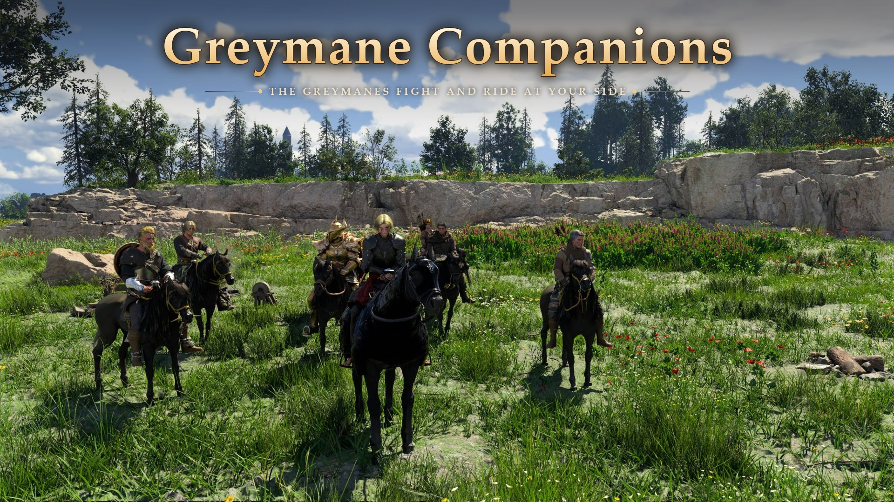

# Greymane Companions

Recruit the Greymanes from your camp as companions in **Crimson Desert**. They follow you through the world, fight at your side, ride with you, and go back to camp when you dismiss them.

Download and full description: Nexus Mods. The player readme is [release/README.txt](release/README.txt).

## Features

- **Recruit**: walk up to a Greymane in your camp, press Ctrl for more talk options and choose Recruit. Up to 6 Greymanes at once, besides Damiane and Oongka. A notice tells you who joined, or that your party is full.
- **Following**: they drop what they were doing in camp and follow you at once, fight with you and kneel when beaten, as Damiane and Oongka do. Left far behind, they catch up with their own green-leaves teleport.
- **Horses**: when you ride they ride with you on horses of their own, kept while they follow you, and get off when you do.
- **Map**: recruited companions are shown on the map and the minimap.
- **Dismiss**: he walks back to what he was doing. One brought to you after a fast travel stays where he is and leaves when you are out of sight.
- **Bring back (F10)**: your companions come to you.
- **Saves**: the party list is saved by the game; after loading, the plugin looks after the Greymanes on it again.

## How it works

Two parts:

- **The talk options** (`Greymane Companions.json`, a DMM v3 JSON mod made by `tools/build_test4.py`): two new interactions, Recruit and Dismiss (copies of the game's Follow and Standby with their own conditions), added to the 38 camp comrades' interaction lists.
- **The plugin** `GreymaneCompanions.asi` (x64, MinHook). The game's mercenary clan does the companion work; the plugin drives it on the game's server thread (a hook on its message dispatch):
  - **Recruit / Dismiss**: the chosen talk option is read where the server accepts an interaction; the comrade goes on or off the accompany list (AccompanyMercenary, RemoveAccompany), without the clan's safe-spot move and without the client-side disband notice, so a dismissed comrade stays and walks home.
  - **Following**: the game's own AI events (Follow, Standby, the catch-up teleport), forwarded to the client that runs her AI; a raised logout distance so the clean-up does not take her home; the chase formation widened from 2 places to 8.
  - **The camp routine**: seven AI-schedule conditions answer "no schedule" for a recruited camp comrade (their vtable entries are swapped), so her AI leaves its task and follows.
  - **Horses**: a plain horse actor is spawned for each comrade and she is seated with the game's own ride-on; the game's ride-off when you dismount.
  - **Map icon**: the client's map icon choice gives recruited comrades the party icon.
  - **Notices**: Direct2D over the game's D3D12 swap chain (HDR aware), shared with Party HUD's overlay code.

[docs/research](docs/research) has the findings (addresses, data layouts, what was tried); [docs/research/notes.md](docs/research/notes.md) is the overview.

## Building

- **Plugin**: Visual Studio 2026 (toolset v145), `msbuild asi/GreymaneCompanions.vcxproj -p:Configuration=Release -p:Platform=x64`; output `asi/bin/GreymaneCompanions.asi`.
- **Talk options and release**: `tools/make_release.py` builds the DMM JSON from your own copy of the game (no game assets are in this repository) and the zip. The table reader `tools/tables.py` uses `game_files.py` from the Character Creator repository's tools to read the game's archives. Python 3 with lz4 and Pillow.
- `tools/make_roster.py` and `tools/display_names.py` make `asi/src/roster.h` (the Greymanes and the names the game shows); `tools/portraits.py` and `tools/make_banner.py` make pictures.

## Credits

- [MinHook](https://github.com/TsudaKageyu/minhook) by Tsuda Kageyu (see `release/THIRD_PARTY.txt`).
